# hyprland-widgets

A matching set of popovers for a [Hyprland](https://hyprland.org) + waybar desktop: network, sound,
calendar, power & display, bluetooth, and a Spotify mini-player. Same Tokyo Night palette,
same JetBrainsMono Nerd Font, same 1px frame, keyboard-first everywhere.

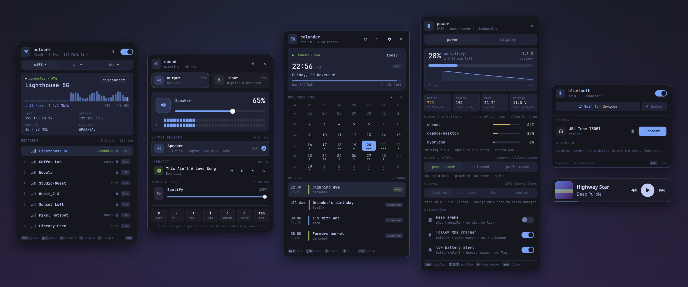

<sub>Screenshots use made-up networks, VPNs and calendars, see [tools/screenshots](tools/screenshots).</sub>

## The widgets

| | widget | what it does | stack |
|---|---|---|---|
| 📶 | [`wifi-widget`](wifi-widget) | Wi-Fi list with live throughput graph, WireGuard/Tailscale tunnels with exit IP and latency, per-network DNS presets with DNS-over-TLS | GTK4 + gtk4-layer-shell, `nmcli`, `resolvectl` |
| 🔊 | [`sound-widget`](sound-widget) | outputs and inputs with live level meters, per-app volume, a hyprspot now-playing strip | GTK4 + gtk4-layer-shell, PipeWire (`wpctl`, `pw-dump`) |
| 📅 | [`hyprcal`](hyprcal) | clock, month grid with week numbers, agenda, Google Calendar (OAuth or secret iCal links) and Calendly, event reminders | GTK4 + gtk4-layer-shell |
| 🔋 | [`hyprpower`](hyprpower) | battery health and history, apps draining it, power profiles, charge modes; brightness, keyboard light, night light, monitor extend/mirror/placement/scale with a 10 s keep-or-revert | GTK4 + gtk4-layer-shell, `upower`, `powerprofilesctl`, `hyprctl` |
| 🎧 | [`hyprbt`](hyprbt) | bluetooth power, scan, pair (with its own BlueZ agent), connect, battery levels | [Quickshell](https://quickshell.org) (QML) |
| 🎵 | [`hyprspot`](https://github.com/eduPHP/hyprspot) | Spotify mini-player with playlists and search, driven by Spotify's headless Connect client | GTK4 + gtk4-layer-shell, Spotify Soloist |
| 🎨 | [`hypr-ui`](hypr-ui) | the shared design system: `tokens.json` → GTK CSS + Python helpers + a QML singleton | Python build script |
| 🖼️ | [`hyprtheme`](hyprtheme) | theme picker: previews a theme and its wallpapers inside itself, fuzzy search, dark/light/favorite filters, undo after applying | GTK4 + gtk4-layer-shell |
| 🚀 | [`hyprmenu`](hyprmenu) | start menu on Super+Space: most-used apps by focus time, the Omarchy menu, search over both, power row | GTK4 + gtk4-layer-shell |
| 🖌️ | [`omarchy-theme`](omarchy-theme) | Omarchy's themes without Omarchy: one command restyles the wallpaper, borders, waybar, mako, fuzzel, terminal, btop, Neovim and every widget here, live | Python |

## Gallery

<table>
<tr><td colspan="3">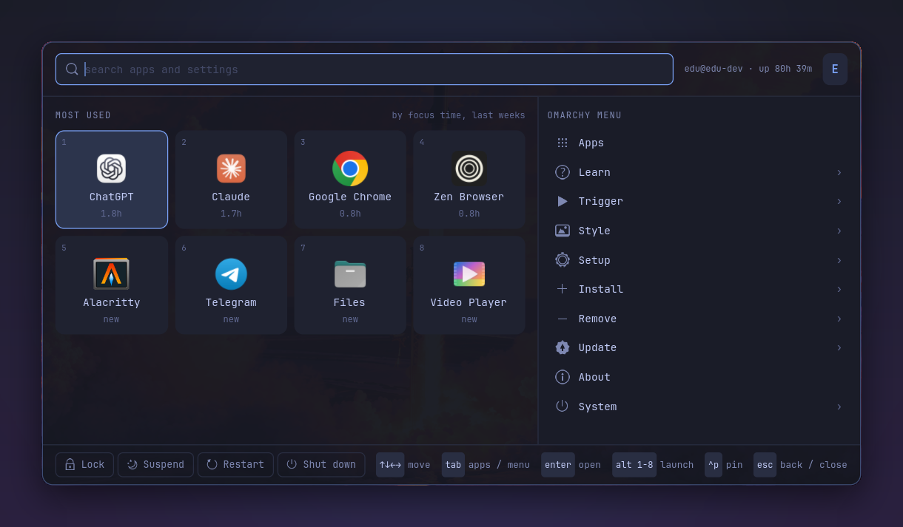</td></tr>
<tr><td colspan="3">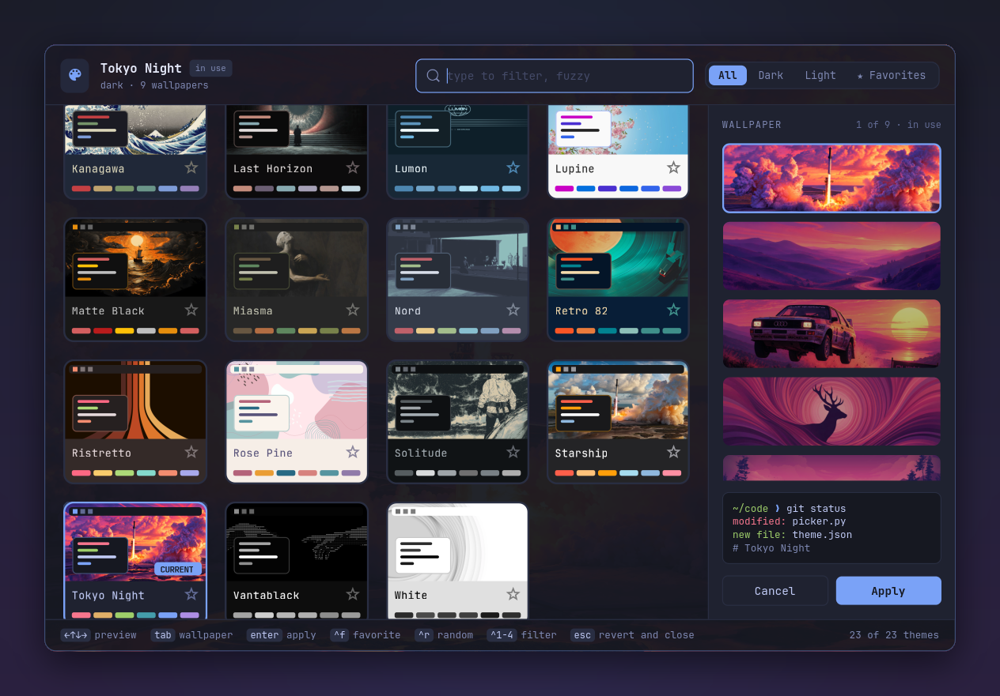</td></tr>
<tr>
<td width="33%">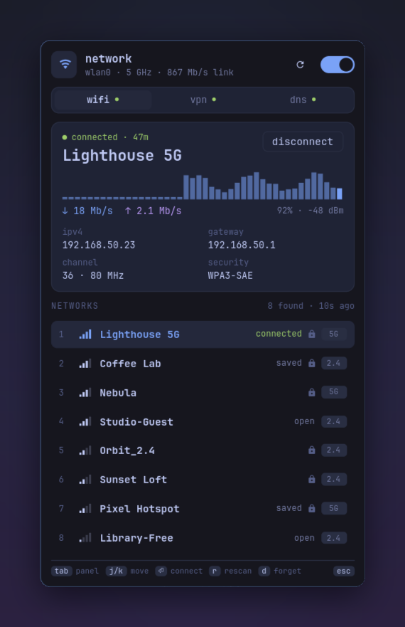</td>
<td width="33%">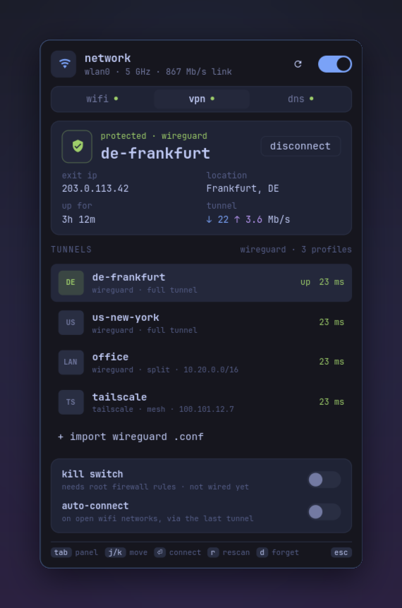</td>
<td width="33%">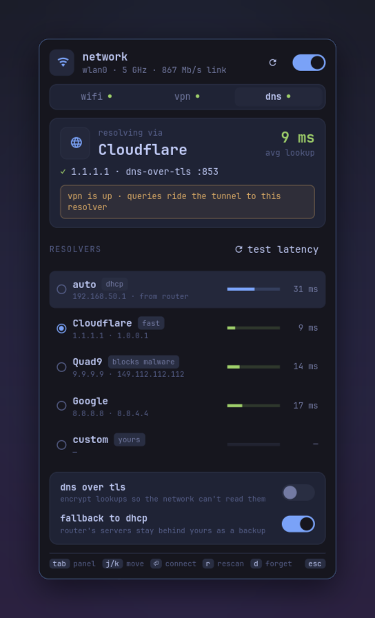</td>
</tr>
<tr><td colspan="3">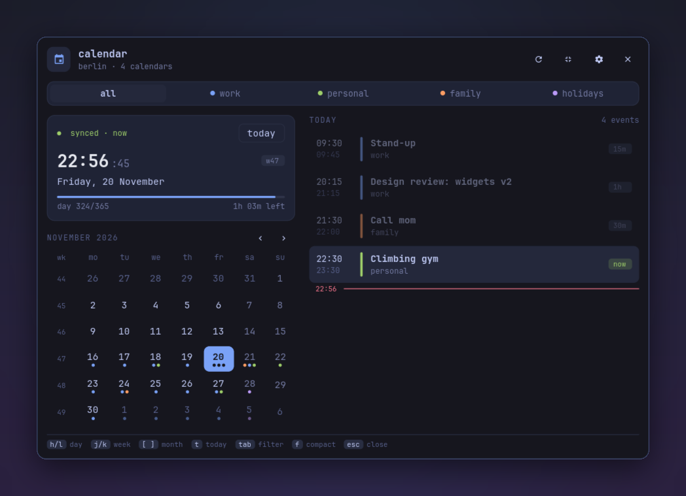</td></tr>
<tr>
<td>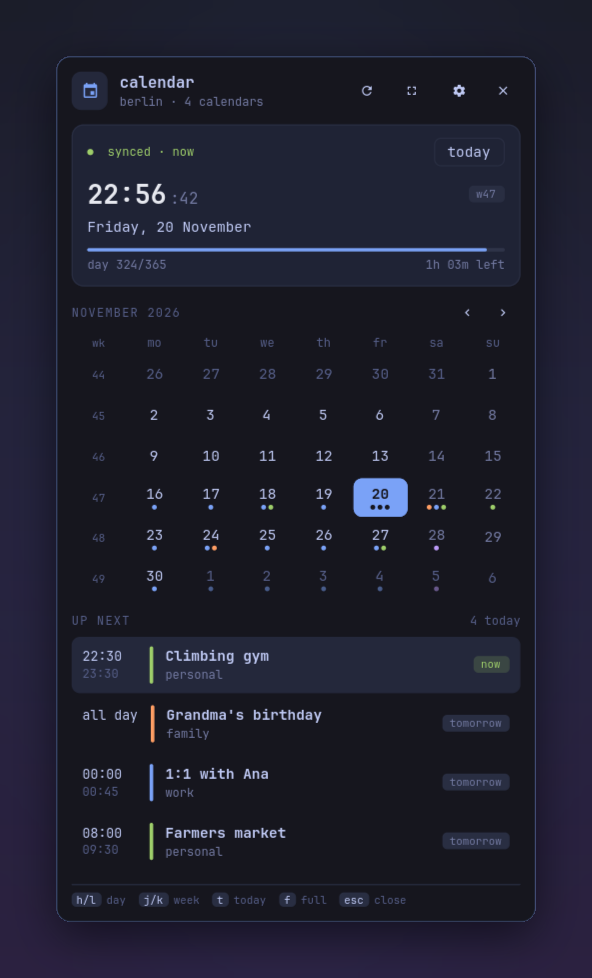</td>
<td>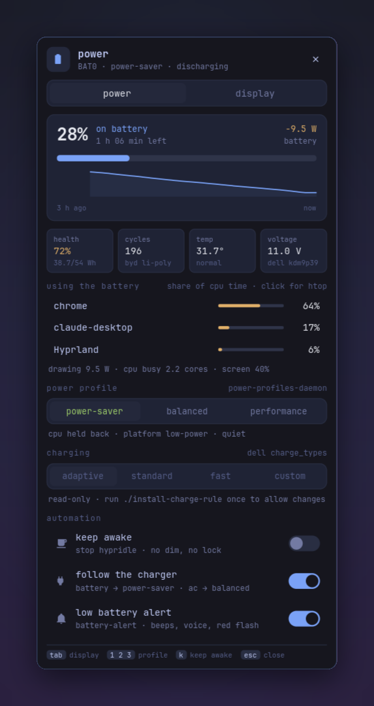</td>
<td>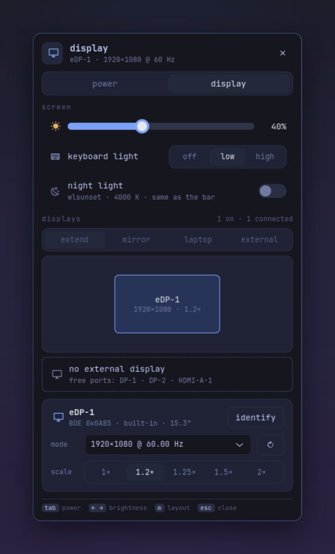</td>
</tr>
<tr>
<td>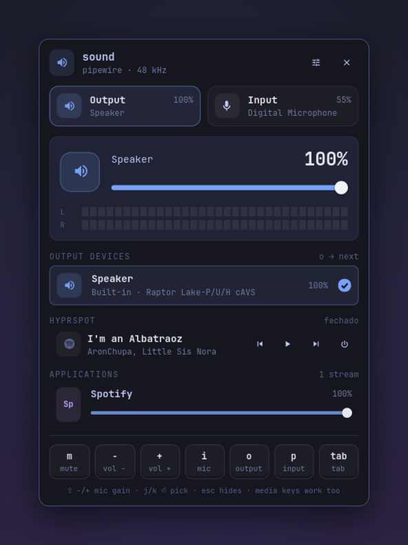</td>
<td>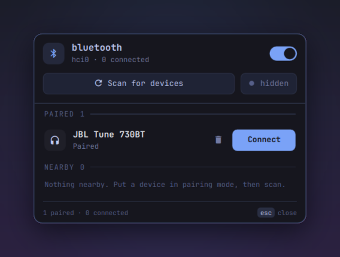</td>
<td></td>
</tr>
</table>

## How they fit together

- **One look.** Every popover takes its colours, radii, spacing and shadow from [`hypr-ui`](hypr-ui).
- **Follows your theme.** `omarchy-theme set gruvbox` (or Super+Ctrl+Shift+Space for the hyprtheme picker) switches all of them,
  hyprspot included, to any of Omarchy's 23 themes, light ones too, without a restart.
- **A start menu.** Super+Space opens [`hyprmenu`](hyprmenu): your most-used apps (by time in focus), the
  Omarchy menu, and a search over both. Super+Alt+Space opens it on the menu side.
- **One at a time.** Opening any popover closes the others (`hypr-ui/bin/hypr-ui-solo`).
- **Resident daemons.** The GTK widgets stay running and toggle instantly; waybar modules call
  `<widget>` on click and `<widget> --status` for their bar text.

## Install

This runs on Ubuntu 26.04 with Hyprland 0.53 and waybar, set up in the style of
[Omarchy](https://github.com/basecamp/omarchy). It should work on any Hyprland setup with these packages:

```bash
sudo apt install python3-gi gir1.2-gtk-4.0 libgtk4-layer-shell0 gir1.2-gtk4layershell-1.0 \
  network-manager pipewire wireplumber upower power-profiles-daemon wlsunset webp-pixbuf-loader
```

You also need [JetBrainsMono Nerd Font](https://www.nerdfonts.com/font-downloads). hyprbt needs Quickshell (`hyprbt/build-quickshell.sh` builds it).
hyprspot lives in its own repository, [eduPHP/hyprspot](https://github.com/eduPHP/hyprspot), with its own setup.
For the themes, run [`omarchy-theme/install.sh`](omarchy-theme) and wire your apps as its README shows.
It also links the [`hyprtheme`](hyprtheme) picker (`webp-pixbuf-loader` lets it show Omarchy's WebP wallpapers).

```bash
git clone https://github.com/eduPHP/hyprland-widgets.git ~/code/hyprland-widgets
cd ~/code/hyprland-widgets
ln -s "$PWD/hypr-ui" ~/.config/hypr-ui
for w in wifi-widget sound-widget hyprcal hyprpower hyprmenu; do ln -s "$PWD/$w/$w" ~/.local/bin/$w; done
ln -s "$PWD/hyprbt" ~/.config/quickshell/hyprbt
```

Then wire them to waybar and Hyprland. The [hypr-ui README](hypr-ui/README.md) lists every widget's
waybar module and keybinding, and the hyprcal, hyprpower and hyprbt READMEs have the full snippets. For example, in `~/.config/hypr/autostart.conf`:

```ini
exec-once = sound-widget --daemon
exec-once = hyprcal --daemon
exec-once = hyprpower --daemon
exec-once = hyprtheme --daemon
exec-once = hyprmenu --daemon
exec-once = qs -c hyprbt -d
```

Keybindings for the theme picker and the start menu, in `~/.config/hypr/bindings.conf` (or wherever your binds live):

```ini
bindd = SUPER CTRL SHIFT, SPACE, Pick theme, exec, hyprtheme
bindd = SUPER, SPACE, Start menu, exec, hyprmenu
bindd = SUPER ALT, SPACE, Start menu (Omarchy menu), exec, hyprmenu menu
```

## Secrets stay out

Nothing personal lives in this repo. Keys, OAuth tokens, iCal secret links and Calendly tokens are read
from `~/.config/<widget>/` at runtime, and `.gitignore` blocks env, key, token and `config.toml` files.

## Screenshots

`tools/screenshots/` regenerates every image here from demo data:
`wifi_demo.py` fakes NetworkManager, VPN and DNS, `hyprcal_demo.py` writes fake calendars,
`capture.sh` grabs a popover, and `compose.py` trims, rounds and lays the images out.

## License

[MIT](LICENSE)
