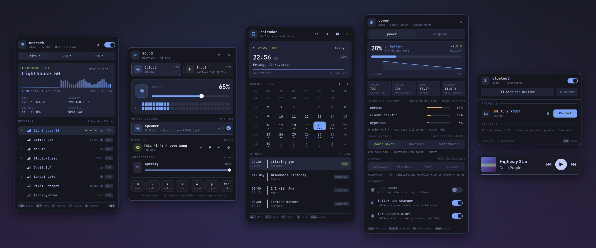

# hypr-ui

One look for every desktop widget on this Hyprland/Omarchy setup: a single
`tokens.json`, rendered for GTK4 and for Quickshell, plus the surface rules that
keep frames and shadows identical everywhere.



## Widget map

| Widget | What it is | Toolkit | Code | Opened by | Surfaces | hypr-ui |
|---|---|---|---|---|---|---|
| **wifi-widget** | Wi-Fi / VPN / DNS popover | GTK4 + gtk4-layer-shell (Python) | `~/code/hyprland-widgets/wifi-widget` | waybar `custom/wifi` click | popover (`wifi-widget`) | yes |
| **sound-widget** | outputs, inputs, apps, hyprspot strip | GTK4 + gtk4-layer-shell (Python daemon, `exec-once sound-widget --daemon`) | `~/code/hyprland-widgets/sound-widget` | waybar `custom/sound`, `custom/mic` | popover (`sound-widget`), volume toast (`sound-widget-osd`) | yes |
| **hyprbt** | Bluetooth power, scan, pair, connect | Quickshell (QML, `exec-once qs -c hyprbt -d`) | `~/code/hyprland-widgets/hyprbt` | waybar `bluetooth` click, `SUPER CTRL B` | popover (`hyprbt`) | yes |
| **hyprcal** | calendar: clock, month, agenda, Google Calendar + Calendly | GTK4 + gtk4-layer-shell (Python daemon, `exec-once hyprcal --daemon`) | `~/code/hyprland-widgets/hyprcal` | waybar `custom/hyprcal` click (compact), right-click or `SUPER ALT C` (full) | popover (`hyprcal`) | yes |
| **hyprpower** | battery details, power profile, Dell charge mode, brightness, keyboard light, monitor layout (extend/mirror/placement/scale) | GTK4 + gtk4-layer-shell (Python daemon, `exec-once hyprpower --daemon`) | `~/code/hyprland-widgets/hyprpower` | waybar `battery` click, `SUPER CTRL P` | popover (`hyprpower`), toast (`hyprpower-toast`), identify (`hyprpower-identify`) | yes |
| **hyprtheme** | theme picker with in-picker preview, wallpapers and undo | GTK4 + gtk4-layer-shell (Python daemon, `exec-once hyprtheme --daemon`) | `~/code/hyprland-widgets/hyprtheme` | `SUPER CTRL SHIFT SPACE` (`omarchy-theme-menu`) | full-screen picker (`hyprtheme`), undo toast (`hyprtheme-toast`) | yes, painted in the highlighted theme while browsing |
| **hyprmenu** | start menu: most-used apps (by focus time), the Omarchy menu, search over both, power row | GTK4 + gtk4-layer-shell (Python daemon, `exec-once hyprmenu --daemon`, also measures app usage) | `~/code/hyprland-widgets/hyprmenu` | `SUPER SPACE` (apps), `SUPER ALT SPACE` (menu) | overlay card (`hyprmenu`) | yes |
| **hyprspot** | Spotify mini player | GTK4 (Python) | `~/code/hyprland-widgets/hyprspot` | always on, bottom-right | pill + expanded card (`hyprspot`, Hyprland blur rule) | no, separate project with its own look |

## Layout

```
tokens.json            the source: colours, type, radii, spacing, shadow, surface geometry
build.py               renders the two outputs below; run it after any change
gtk/hypr-ui.css.in     GTK base stylesheet template ({{token.path}} placeholders)
gtk/hypr-ui.css        generated
gtk/hypr_ui.py         GTK helper: load_css(), popover(), toast(), solo(), rgb()/hex_color() for drawn colours
theme.py               maps the Omarchy theme's palette onto the colour tokens (see Themes)
bin/hypr-ui-solo       closes the other popovers when one opens
qml/Tokens.qml         generated Quickshell singleton (Tokens.blue, Tokens.sizeBody, …)
skill/SKILL.md         Claude Code skill (/hypr-ui), linked at ~/.claude/skills/hypr-ui
```

`~/.config/hypr-ui` is a symlink to this folder; widgets reference that path.

## Tokens

- **Colour** (Tokyo Night): `bg #16161e`, `surface #1f2335`, `raised #24283b`, `line #292e42`,
  `frame #3f537d`, `fg #c0caf5`, `bright`, `muted`, `faint`; accents `blue` (primary),
  `green` (connected/ok), `orange` (input/warn), `amber`, `red`, `purple`, `cyan`; `ink` for text on `blue`.
- **Type**: JetBrainsMono Nerd Font throughout. Sizes micro 9 · small 10 · caption 11 · body 12 · title 13 · icon 15 · big 18 · hero 22.
- **Radius**: surface 12 · card 10 · control 7 · chip 4 · toast 16.
- **Space**: pad 12 · gap 10 · row 7×8. Controls are 30px tall; header/device tiles 30px.
- **Shadow**: `0 4px 12px` black at 38%.
- **Surface**: popovers sit 6px under the bar and 8px from the right edge.

## Surface rules (why borders looked off)

1. **Opaque 1px frame** (`frame`). The screen runs at 1.2× scale, so a 1px line covers
   1.2 device pixels; a translucent border then blends differently on each side and
   reads as uneven "transparency". An opaque colour stays even.
2. **Room for the shadow.** The layer surface is `surface.margin` (16px) larger than the
   card on every side, so the shadow is never clipped at the surface edge. The layer
   margins are negative by the same amount, so the card stays where it was.
3. **That margin is click-through** (input region / QML `mask`), so clicking just
   outside the card still closes it.
4. **One shadow size** everywhere; no per-widget drop shadows.
5. **One popover at a time.** Opening a popover runs `bin/hypr-ui-solo <name>`, which closes
   the others. Each popover keeps a flag file `$XDG_RUNTIME_DIR/<name>.open` while it is
   open and has a close command that `hypr-ui-solo` calls:

   | name | flag file | close command |
   |---|---|---|
   | wifi | `wifi-widget.open` | D-Bus action `close` on `dev.edu.WifiWidget` |
   | sound | `sound-widget.open` | `sound-widget close` |
   | hyprbt | `hyprbt.open` | `qs -c hyprbt ipc call bt close` |
   | hyprcal | `hyprcal.open` | `hyprcal close` |
   | hyprpower | `hyprpower.open` | `hyprpower close` |
   | hyprtheme | `hyprtheme.open` | `hyprtheme close` |

6. **Screenshots cover the widgets.** Widgets live on the OVERLAY layer, which Hyprland
   draws above even fullscreen windows, so Flameshot's overlay used to sit *under* them.
   `~/.local/bin/flameshot-gui` waits for the overlay window (the grab is already taken, so
   the widgets are in the picture), makes it real fullscreen and keeps
   `$XDG_RUNTIME_DIR/hypr-ui-capture` until it closes; meanwhile every widget steps down
   to TOP, under the overlay. GTK: set the layer with `hypr_ui.layer(win, Layer, Layer.Layer.OVERLAY)`
   instead of `Layer.set_layer`. Quickshell: the `capturing` FileView in `hyprbt/shell.qml`.
   hyprspot has the same watcher in `hyprspot/ui/window.py`.

## Components

| | GTK class | Quickshell |
|---|---|---|
| popover / toast | `.popover`, `.toast` on the root box | `frame` Rectangle in `hyprbt/shell.qml` |
| header | `.app-icon` `.title` `.subtitle`, `button.icon` | header Item in `shell.qml` |
| buttons | `button.primary` `.ghost` `.link` `.icon` | `Btn { variant }` |
| switch | `switch` (38×20, 16px knob) | power switch in `shell.qml` |
| card, tabs | `.card`, `.tabs` + `button.tab` | – |
| lists | `.section` `.section-meta` `.row` `.row.selected` `.badge` | `SectionHeader`, `DeviceRow` |
| footer | `.footer` `.key` `.hint` | footer Item in `shell.qml` |

Widgets keep only their own rules in their `style.css` and may override any base rule.

## Adding a widget

### GTK4 (Python + gtk4-layer-shell)

```python
sys.path.insert(0, os.path.expanduser("~/.config/hypr-ui/gtk"))
import hypr_ui

hypr_ui.load_css(HERE / "style.css")   # in Application.do_startup; style.css holds only this widget's rules
hypr_ui.popover(window, Layer)         # top-right popover, instead of set_anchor/set_margin
# or hypr_ui.toast(window, Layer, bottom=88) for a bottom pop-up
root.add_css_class("popover")          # or "toast"
root.set_size_request(360 + 2 * hypr_ui.MARGIN, -1)   # size requests include the shadow margin
```

Build the content from the base classes (see Components): `.app-icon` `.title` `.subtitle`
header, `button.primary`/`.ghost`/`.icon`, `switch`, `.card`, `.section` + `.row`, `.footer` + `.key`.
Use `@blue`, `@fg`, `@muted`… in your own CSS, never hex values.

### Quickshell (QML)

```bash
cd ~/.config/quickshell/<widget> && ln -s ~/code/hyprland-widgets/hypr-ui/qml/Tokens.qml Tokens.qml
```

Then use `Tokens.blue`, `Tokens.fontFamily`, `Tokens.sizeBody`, `Tokens.radiusSurface`, … Copy the
PanelWindow from `hyprbt/shell.qml` (negative margins, `mask: Region { item: card }`, the hidden
`shadowShape` + MultiEffect, the `frame` Rectangle) and, if useful, `Btn.qml`, `Txt.qml`,
`SectionHeader.qml`.

### Joining the one-popover rule

1. While open, keep `$XDG_RUNTIME_DIR/<name>.open`; delete it on close.
2. As it opens, run `hypr-ui-solo <name>` (`hypr_ui.solo("<name>")` in GTK,
   `Quickshell.execDetached([…/hypr-ui-solo, "<name>"])` in QML).
3. Give it a close command and add a three-line block for it in `bin/hypr-ui-solo`.

### Other toolkits (waybar, eww, AGS, rofi…)

`tokens.json` is plain JSON. Add an output to `build.py` (it already renders a CSS template
and a QML file) so the new format is regenerated with the others.

## Changing the look

```bash
cd ~/code/hyprland-widgets/hypr-ui && ./build.py
sound-widget quit; setsid -f sound-widget --daemon
pkill -f code/wifi-widget/wifi-widget     # next waybar click starts it again
```

hyprbt reloads by itself. Pre-migration copies are in each widget's `.bak-hypr-ui*` folder.

## Themes

The colours follow the current [Omarchy theme](../omarchy-theme). `theme.py` runs as a theme-set
hook, maps the theme's palette onto the 18 colour tokens and writes them to
`~/.local/state/hypr-ui/theme.json`. The GTK helper and `Tokens.qml` watch that file, so every
widget repaints live with no restart. Without the file, the `tokens.json` colours are used.

Secondary text stays legible whatever the palette: `muted` reaches 4.5:1 and `faint` 3:1 against
`bg` and `surface`, the accent 3:1 against `bg`, and `ink` 4.5:1 on the accent. A colour that falls
short is moved toward `fg` just far enough (`legible()` in `theme.py`).

```bash
./theme.py --print    # the mapping for the current theme
./theme.py --reset    # back to tokens.json
```

Widgets must not hardcode colours. CSS uses the `@` names. Cairo drawing calls
`hypr_ui.rgb("red")` / `rgba("fg", 0.1)` at draw time, and Pango markup uses `hypr_ui.hex_color("muted")`.
Light themes exist, so tint with `alpha(@fg, …)`, not `alpha(white, …)`.
