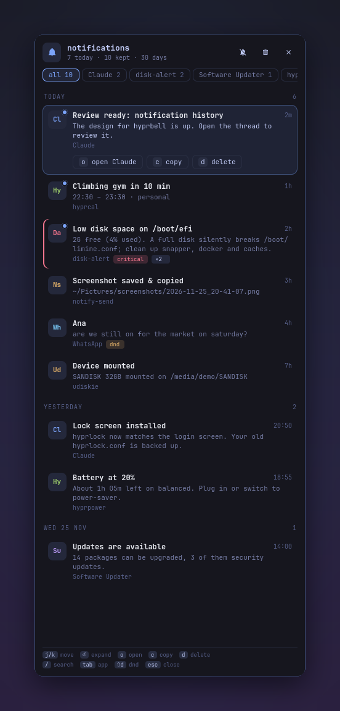

# hyprbell

Notification history in the hypr-ui look. mako keeps showing the popups exactly as before;
hyprbell writes down every notification with its time and shows them in a panel docked to the
right edge of the screen, under the bar.



- **A real history.** mako only remembers its last 5 notifications, in memory, without times.
  The hyprbell daemon listens on the session bus for every `Notify` call (a read-only D-Bus
  monitor, no root) and appends it to `~/.local/state/hyprbell/history.jsonl`. It keeps 30 days or
  1,000 entries, whichever comes first.
- **Nothing silenced gets lost.** Notifications that arrive during do-not-disturb are logged and
  tagged `dnd`. Spotify track changes are skipped (mako hides them too), and so are notifications
  the app marks as transient, like volume OSDs.
- **Grouped by day**, newest first. The same title from the same app on the same day folds into
  one row with a `×2` badge; expanding it lists the earlier ones. Critical ones get a red edge.
  Rows that arrived since you last opened the panel have a dot.
- **Filter by app** with the chips (or Tab), and **search** title, text and app with `/`.
- **Open what it was about.** While the popup is still on screen (`on screen` badge) its action
  buttons work, through mako. Once it is gone, `o` focuses the app's window or launches it from its
  desktop entry. Screenshots open in Satty, the same as clicking the popup.
- **Copy** title and text with `c`, **delete** one row with `d` (`u` undoes), clear everything with
  the trash button (it asks for a second press).
- **Do not disturb.** The bell-off button (or `D`) toggles mako's `do-not-disturb` mode, the same
  mode the actions bar uses.

## Use

```
hyprbell                 toggle the panel (starts the daemon on first run)
hyprbell open | close | quit
hyprbell dnd             toggle mako's do-not-disturb mode
hyprbell log [n]         print the last n notifications in the terminal
hyprbell --status        JSON lines for the waybar bell
```

Opened by `SUPER CTRL N` and by the bell next to the clock in waybar. The bell shows how many
arrived since you last looked and turns into a bell-off icon during do-not-disturb; right-click it
to toggle do-not-disturb. Mako's own `SUPER ,` keys (dismiss, dismiss all, invoke, restore,
silence) are untouched.

## Keys

| key | does |
|---|---|
| j / k, ↓ / ↑ | move |
| Enter, Space | expand or collapse the row (the expanded row follows j / k) |
| o | open: the popup's action while it is on screen, else the app |
| c | copy title and text |
| d, Delete | delete the row; u undoes |
| / | search; Esc clears it, then closes it |
| Tab, Shift+Tab | next / previous app |
| Shift+D | do not disturb |
| Shift+X | clear all (press twice) |
| g / G | first / last row |
| Esc | close the search, then collapse the row, then close the panel |

A click outside the panel closes it.

## Install

```bash
./install.sh
```

links `hyprbell` into `~/.local/bin` and prints the lines to add: `exec-once = hyprbell --daemon`,
the `SUPER CTRL N` bind, and the waybar module and its style:

```jsonc
"modules-center": [ ..., "custom/hyprcal", "custom/hyprbell" ],
"custom/hyprbell": {
  "exec": "hyprbell --status",
  "return-type": "json",
  "restart-interval": 5,
  "tooltip": true,
  "on-click": "hyprbell",
  "on-click-right": "hyprbell dnd"
}
```

```css
#custom-hyprbell { padding: 0 7px; margin: 3px 0 3px 2px; border-radius: 5px; }
#custom-hyprbell.unread { color: @accent; }
#custom-hyprbell.dnd { color: @yellow; }
#custom-hyprbell.open { background-color: alpha(@accent, 0.18); color: @accent; }
```

It needs mako (any daemon that owns `org.freedesktop.Notifications` is logged; do-not-disturb and
the action buttons talk to mako).

## Files

| | |
|---|---|
| `hyprbell` | CLI + launcher (no GTK, fast) and the waybar status |
| `monitor.py` | the session-bus listener |
| `store.py` | the history file, retention, what counts as new |
| `widget.py` | the daemon: logger and panel |
| `style.css` | only hyprbell's own rules; the rest is hypr-ui |
| `~/.local/state/hyprbell/history.jsonl` | the history, one notification per line, plain text, never leaves the machine |
| `~/.local/state/hyprbell/seen` | when you last opened the panel |

The README screenshot comes from a demo copy with made-up notifications:
[`tools/screenshots/hyprbell_demo.py`](../tools/screenshots/hyprbell_demo.py).
