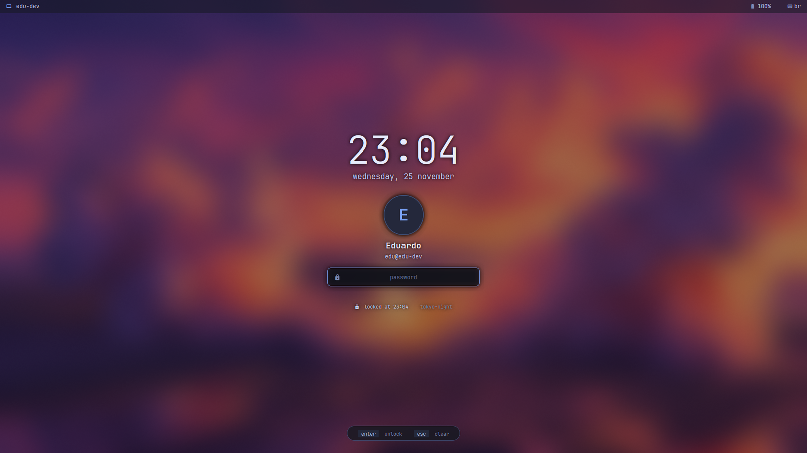
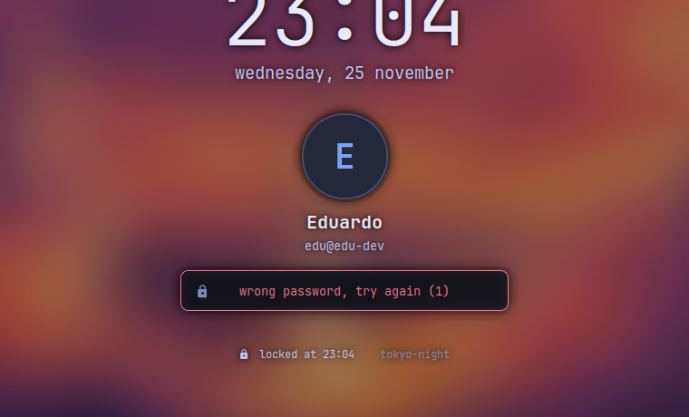
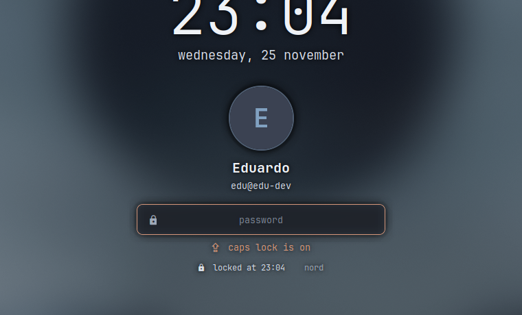
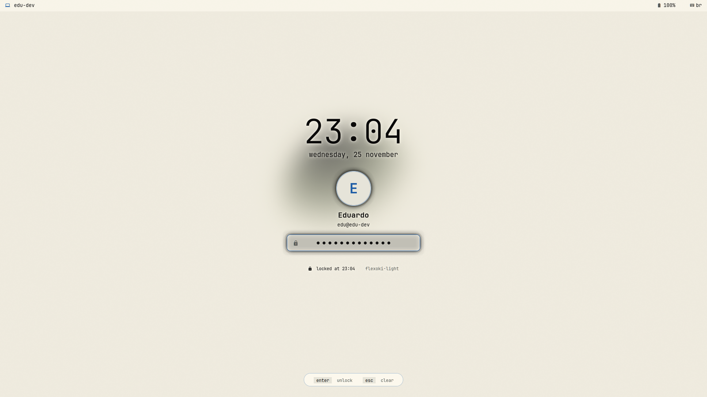
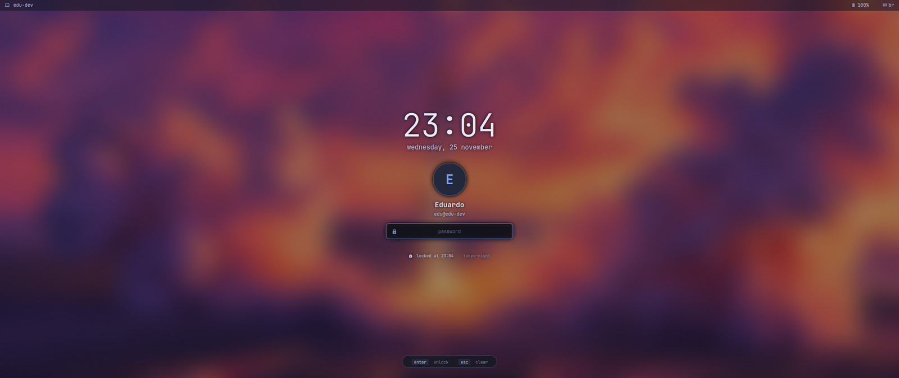

# hyprlock-theme

The [hyprlock](https://github.com/hyprwm/hyprlock) lock screen in the [hypr-ui](../hypr-ui) look, to
match [hyprlogin](../hyprlogin): the same clock and date over the blurred, dimmed Omarchy wallpaper, the
same top strip, and your avatar, name and password field sitting straight on the wallpaper. It follows
the Omarchy theme: `omarchy-theme set gruvbox` changes the next lock too.



<table><tr>
<td width="50%"></td>
<td width="50%"></td>
</tr></table>



On the 2560×1080 ultrawide everything keeps its size and stays centred; the screen just shows more wallpaper:



## What's on it

- **Clock and date** in JetBrainsMono Nerd Font (the clock in Light), with a soft shadow.
- **Avatar, name, `user@host`**: `~/.face` in a circle with the theme's frame colour (your initial on a
  tile if there is no `~/.face`), the full name from your account.
- **The password field**: outline in the accent colour; orange while caps lock is on, green while it
  checks, red with "wrong password, try again (n)" after a failure. Esc clears it.
- **Under the field**: "caps lock is on" while it is, then when the screen was locked and the theme name.
- **Top strip** the height of waybar: hostname on the left; caps lock, battery and keyboard layout on the right.
- **Key hints** pill at the bottom. Every monitor gets the full screen.

What hyprlogin has that this hasn't, because hyprlock can't do it: a session chooser, power buttons, a
show-password eye or a submit button (Enter is the only way in), left-aligned dots (hyprlock centres
them), and the shake on a wrong password.

## Install

```bash
hyprlock-theme/hyprlock-theme check       # what it needs
hyprlock-theme/install.sh                 # no root; --dry-run prints every step
hyprlock-theme preview                    # lock now to see it (unlock with your password)
hyprlock-theme preview --theme gruvbox    # another theme, without switching to it
```

`install.sh`:

1. copies `~/.config/hypr/hyprlock.conf` to `hyprlock.conf.before-hyprlock-theme` (once; a later run
   never overwrites that backup);
2. writes the look for the current theme to `~/.local/state/hyprlock-theme/hyprlock.conf`;
3. replaces `~/.config/hypr/hyprlock.conf` with one `source =` line pointing there, so whatever runs
   `hyprlock` (hypridle, a keybind, `loginctl lock-session`) gets it;
4. links `hyprlock-theme` as an omarchy-theme hook (`~/.config/omarchy/hooks/theme-set.d/`) and into `~/.local/bin`.

`hyprlock-theme/install.sh --uninstall` puts the backup back and removes the rest.

## How it follows the theme

hyprlock runs as you, so unlike hyprlogin nothing needs copying out of your home. `hyprlock-theme sync`
reads the colours hypr-ui resolved for the current theme (`~/.local/state/hypr-ui/theme.json`) and
writes a complete hyprlock config with them; the wallpaper is read live from
`~/.config/omarchy/current/background`. As a theme-set hook it waits for hypr-ui's hook to write the new
palette first. The Omarchy theme's own `hyprlock.conf` colours aren't used.

Sizes are hypr-ui px × 1.2, the scale hyprlogin draws at on a 1080 px tall screen, so the two screens
line up (`HYPRLOCK_THEME_SCALE` changes it). The layout and sizes live in `hyprlock-theme`'s
`conf_text()`; edit them there rather than in the generated file, which every theme change rewrites.

The strip, the caps line and the "locked at" line are hyprlock `cmd[]` labels running [`bits`](bits), a
small sh script that reads `/sys` (caps LED, battery) and `hyprctl devices` (layout).

## Screenshots

```bash
tools/screenshots/hyprlock.sh                         # the README set into docs/screenshots
tools/screenshots/hyprlock.sh /tmp/out x:gruvbox:fail # any theme and state: caps, fail, typing
```

It never locks your session: it starts a nested Hyprland (parked on a hidden special workspace) with two
headless monitors the size of edu-dev's, locks that one and grabs it with grim. The avatar is your
initial so your photo doesn't end up in the repo (`AVATAR=~/.face` to use it).

## Files

```
hyprlock-theme/
  hyprlock-theme   sync | preview | check, and the omarchy-theme hook; the layout is in conf_text()
  bits             sh helper for the cmd[] labels (strip, caps, locked)
  install.sh       backs up and wires ~/.config/hypr/hyprlock.conf, links the hook
```
