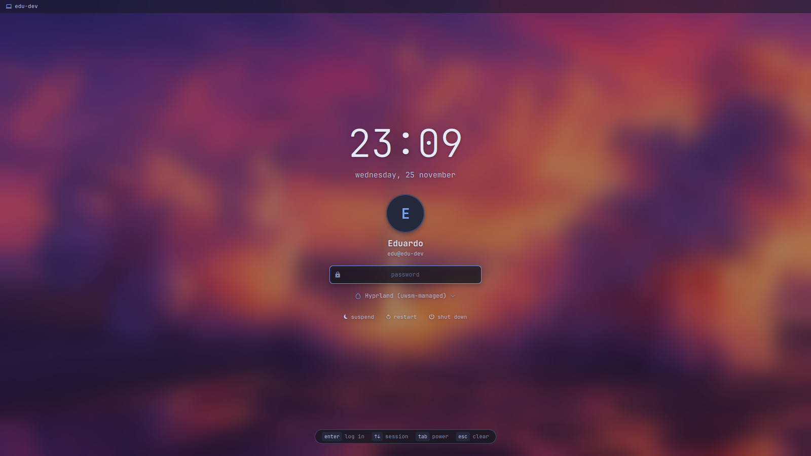
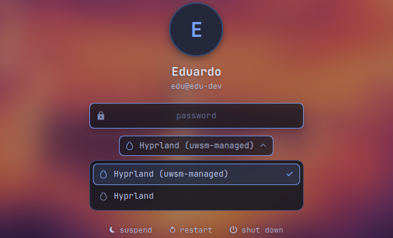
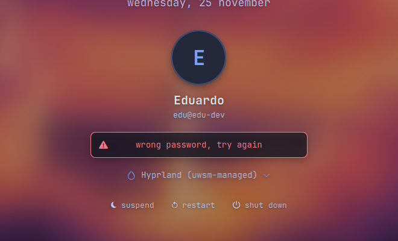
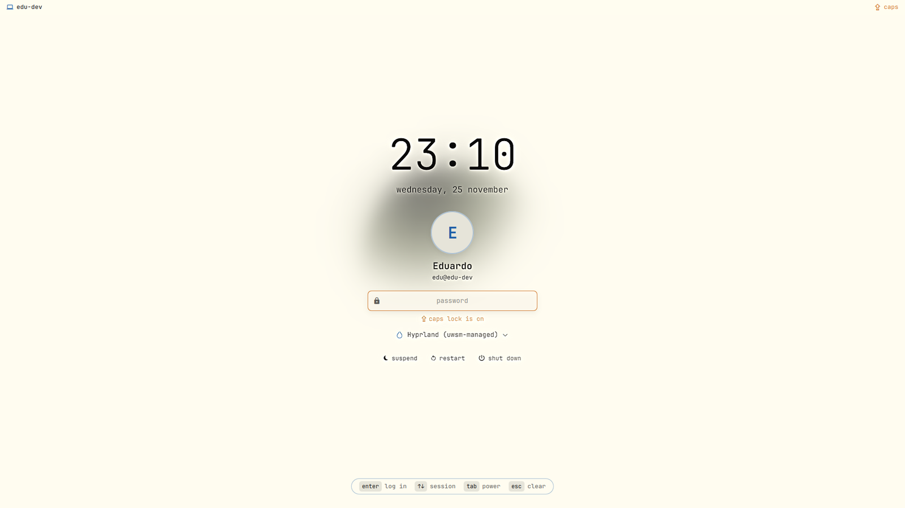

# hyprlogin

The SDDM login screen in the [hypr-ui](../hypr-ui) look, laid out like the lock screen
([hyprlock-theme](../hyprlock-theme)): clock, avatar, name and password field straight on the blurred
Omarchy wallpaper, no box around them, with the same field, colours, shadows and key-hint pill. It follows the Omarchy
theme: `omarchy-theme set gruvbox` changes the login screen too, with no sudo.



<table><tr>
<td width="50%"></td>
<td width="50%"></td>
</tr></table>



## What's on it

- **Clock and date** over the wallpaper, which is blurred and dimmed (35% of the theme's background), as on
  the lock screen.
- **No box** (same as hyprlock-theme v2): a 76 px round avatar with a frame border (or your initial), name,
  `user@host`, then a 300×36 password field in the theme's background at 72% with an accent outline. Text has
  a soft shadow so it reads on any wallpaper.
- **Below the field**: the session as a quiet line that opens a small list, and suspend / restart / shut down
  as text buttons. Restart and shut down ask for a second press.
- **States**: the outline turns orange with caps lock (plus a warning line and "caps" in the top strip), green
  while logging in, red on a wrong password, which also clears the field and shakes the stack.
- **Top strip** the height of waybar: hostname, caps lock, keyboard layout.
- **Second monitor**: wallpaper and the strip with a clock; the card stays on the primary screen
  (`allScreens=true` in theme.conf puts it on every screen).

| key | does |
|---|---|
| `enter` | log in |
| `↑` `↓` | change session |
| `alt ←` `alt →` | change user (when there is more than one) |
| `tab` | move to the session chooser and the power buttons |
| `esc` | clear the password, or close the session list |

## Install

Check what it needs first (nothing here needs root):

```bash
hyprlogin/hyprlogin check
hyprlogin/hyprlogin preview                 # the real theme in sddm-greeter --test-mode, nothing installed
hyprlogin/hyprlogin preview --theme gruvbox --state error
```

Then, as yourself with sudo:

```bash
sudo hyprlogin/install.sh --keymap br       # --keymap: the layout weston uses for the password field
```

`install.sh --dry-run` prints every step. It:

1. copies the theme to `/usr/share/sddm/themes/hyprlogin`, with JetBrainsMono Nerd Font from your fonts
   (the greeter runs as the `sddm` user, which can't read `~/.local/share/fonts`);
2. creates `/var/lib/hyprlogin`, owned by you, and links the theme's `theme.conf.user` to the
   `theme.conf` there; `hyprlogin sync` writes the theme's colours and a copy of the wallpaper into it;
3. copies `~/.face` to `/var/lib/AccountsService/icons/<you>` if you have no login avatar yet
   (your home is `750`, so SDDM can't read `~/.face` itself);
4. links `hyprlogin` as an omarchy-theme hook (`~/.config/omarchy/hooks/theme-set.d/hyprlogin`) and into `~/.local/bin`;
5. writes `/etc/sddm.conf.d/20-hyprlogin.conf` with `[Theme] Current=hyprlogin`. It sorts after
   `10-hyprland.conf`, so it wins without editing that file. With `--keymap`, it also points weston at
   `/etc/sddm/hyprlogin-weston.ini` (`[keyboard] keymap_layout=…`); without it, weston types in `us`.

`sudo hyprlogin/install.sh --uninstall` removes all of it except the avatar; SDDM falls back to the theme
named in the other conf files (maui on edu-dev).

### Needs

| | package |
|---|---|
| SDDM with the Qt 6 greeter | `sddm` |
| QML: QtQuick, QtQuick.Effects (blur, shadow, avatar mask, `RectangularShadow` needs Qt 6.9+) | `qml6-module-qtquick`, `qml6-module-qtquick-effects` |
| WebP and JPEG wallpapers | `qt6-image-formats-plugins` |
| the font | JetBrainsMono Nerd Font (Regular, Bold, Light) |

## How it follows the theme

`hyprlogin sync` reads the colours hypr-ui resolved for the current theme
(`~/.local/state/hypr-ui/theme.json`, written by `hypr-ui/theme.py`) and the wallpaper
(`~/.config/omarchy/current/background`), and writes them to `/var/lib/hyprlogin`. As a theme-set hook it
waits for hypr-ui's hook to finish first, since omarchy-theme starts them all at once.

`theme.conf` holds the defaults (hypr-ui's `tokens.json`, Tokyo Night) and the knobs:
`blur` (0–1, 1.0 matches hyprlock-theme), `dim` (veil opacity), `scale` (1.2 matches the desktop's 1.2× on a 1080p panel),
`allScreens`. Put your own values in `/var/lib/hyprlogin/theme.conf` only if you stop the hook;
`sync` rewrites that file.

## Files

```
theme/Main.qml        the screen: wallpaper, strip, clock, avatar, field, session, power, key hints
theme/Theme.qml       tokens: colours, sizes, radii, read from theme.conf / theme.conf.user
theme/Btn.qml Txt.qml Key.qml   hypr-ui button, text, key hint
theme/theme.conf      defaults; theme/metadata.desktop
hyprlogin             sync, preview, check (and the theme-set hook)
install.sh            the system install, needs sudo
```

README screenshots: `tools/screenshots/hyprlogin.sh` (runs each state in test mode and grabs it with grim).
